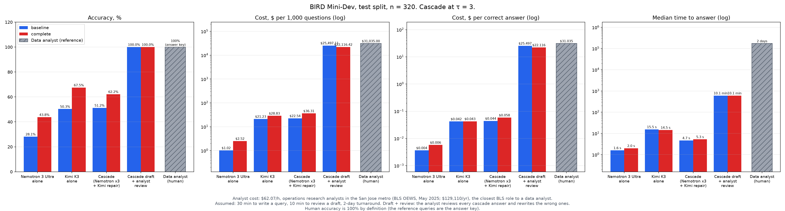

# Countersign

SQL drafted by NVIDIA Nemotron, signed off by analysts. Built at the Fireworks, Microsoft and NVIDIA buildathon, San Francisco, 2 November 2026. Repository: `eval-harness`.

## What it does

A business user asks a question in plain English. Countersign turns it into a database query (SQL), runs it, and hands an analyst a working draft to approve.

1. NVIDIA Nemotron 3 Ultra writes three drafts, using real example values from the database.
2. All three run on the database. If they disagree or fail, Kimi K3 reviews them and writes a corrected query.
3. An analyst signs off on every answer.

## Results

On 350 held-out questions from the BIRD Mini-Dev benchmark:

| Setup | Right answers |
| --- | --- |
| Nemotron 3 Ultra alone | 43.4% |
| Kimi K3 alone (baseline) | 68.0% |
| **Countersign, Kimi K3 checks every question** | **75.7%** |

- Countersign beats the baseline by 7.7 points (95% CI +2.6 to +12.9; p = 0.006).
- Showing the models real data values added 16 to 17 points to both.
- With an analyst reviewing every draft, each analyst handles 43% more questions at 30% lower cost (based on assumed review and writing times).

Full write-up with assumptions: [`WRITEUP.md`](WRITEUP.md). Slides and a 2-minute script: [`presentation/`](presentation/).



## How the check works

- Nemotron writes three queries. Each runs read-only, with a 5-second limit and a 10,000-row cap.
- Drafts that return the same rows count as agreeing. A crash, timeout or empty result never counts as agreement.
- **τ (tau)** is how many drafts must agree to skip Kimi K3. τ = 0 never calls Kimi; τ = 3 calls Kimi unless all three agree; τ = 4 can't be met with three drafts, so Kimi checks every question.
- τ is the one setting we tuned. We test every value from 0 to 4 on 150 questions, pick the most accurate (a tie within 1 point goes to the cheaper one), and report it on the other 350. `split.json` fixes which questions are which; do not regenerate it.

## Reproduce the results (no API key needed)

Every question's result from both runs is saved in `results/`: `baseline.json` (no example values) and `complete.json` (the reported run).

```bash
pip install -r requirements.txt

# The full results table: all 350 test questions
python results_chart.py results/complete.json --split test --tau 3

# Before vs after example values, and both charts: the 320 questions both runs answered
python results_chart.py results/baseline.json results/complete.json --split test --tau 3 \
  --out results/chart_compare.png --bars-out results/chart_bars.png
```

See four questions before and after example values, without any API calls:

```bash
python demo.py --compare
```

## Run the full evaluation (needs a Fireworks API key)

### Setup

```bash
python3.11 -m venv .venv
source .venv/bin/activate
pip install -r requirements.txt
export FIREWORKS_API_KEY=...
```

The 500 questions are in git. Download the 11 SQLite databases:

```bash
curl -L -o /tmp/minidev.zip https://bird-bench.oss-cn-beijing.aliyuncs.com/minidev.zip
unzip /tmp/minidev.zip "minidev/MINIDEV/dev_databases/*/*.sqlite" -d /tmp/minidev
mkdir -p data/MINIDEV
mv /tmp/minidev/minidev/MINIDEV/dev_databases data/MINIDEV/dev_databases
```

You should then have `data/MINIDEV/mini_dev_sqlite.json` and 11 folders named `dev_databases/<db_id>/<db_id>.sqlite`. Questions are CC BY-SA 4.0.

### Run

```bash
python negative_control.py              # grader check: correct query 20/20, broken queries 0/20
python passes.py --stage all            # all model calls; every call is cached
python analyze.py --split tune          # tests every τ and prints the chosen one
python analyze.py --split test --tau 4  # final table and chart
python results_chart.py --export rows.pkl results/complete.json   # save per-question results
```

Live service: set `TAU` in `harness/config.py`, then `uvicorn serve:app --port 8000` and open the `/ask` page.

## Models

All models run on Fireworks serverless. Prices are dollars per 1 million tokens, input / output.

| Role | Model | Price |
| --- | --- | --- |
| Drafts | `accounts/fireworks/models/nemotron-3-ultra-nvfp4` (NVIDIA Nemotron 3 Ultra, reasoning off) | 0.60 / 2.40 |
| Drafts backup | `accounts/fireworks/models/gpt-oss-120b` | 0.15 / 0.60 |
| Fixes | `accounts/fireworks/models/kimi-k3` | 3.00 / 15.00 |
| Fixes backup | `accounts/fireworks/models/glm-5p3` | 1.40 / 4.40 |

`gpt-oss-120b` and the original draft model (`nemotron-lightning-3p5-30b-a3b`, replaced on event day) are scheduled for serverless shutdown on 7 November 2026. Record any model switch in `CHANGELOG.md`.

## Code

| Path | What it does |
| --- | --- |
| `harness/cascade.py` | One question: three drafts, the agreement check, then the fix |
| `harness/gate.py` | The agreement rule |
| `harness/sql.py` | Runs SQL safely, compares results, and builds the schema with example values |
| `harness/prompts.py` | The prompts |
| `harness/llm.py` | Cached, metered Fireworks calls |
| `harness/scoring.py` | Accuracy, cost, time and the choice of τ |
| `harness/service.py` | The live `/ask` page |
| `harness/config.py` | Models, prices, limits and `TAU` |
| `passes.py`, `analyze.py`, `serve.py` | The commands above |
| `results_chart.py`, `results/` | Saved results per run and the charts |
| `demo.py` | Before/after walkthrough of example values, no API calls needed |
| `presentation/` | Slides, the script that builds them, and the 2-minute speech |
