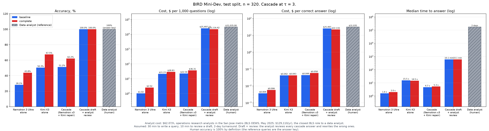
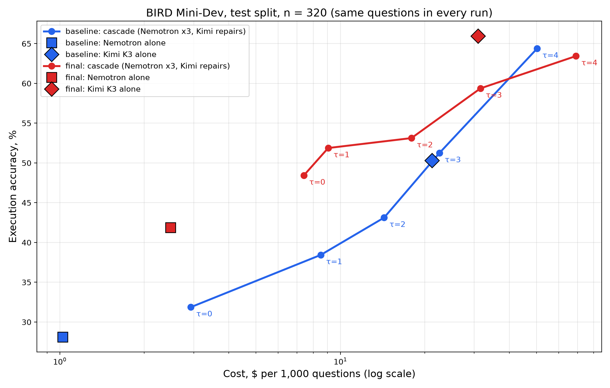

# Write-up

## Project name

FirstDraft: Nemotron-first text-to-SQL, analyst-approved

## Overview

**Business questions answered in minutes, not days. Analysts answer 43% more of them.**

### The problem

Every business decision waits on a data question: which region is slipping, which customers churned, which product line grew. Those questions reach the data through SQL, and SQL sits with a small team of analysts.

- Business users queue for an analyst and wait days for an answer.
- Analysts spend skilled hours writing routine queries instead of analyzing results.
- Many questions never get asked, because the wait is not worth it.
- Fully automatic AI is not safe to act on alone. On our test set, the strongest single model is wrong on one question in three, and nothing in its output says which.

The bottleneck is time-to-decision and analyst capacity.

### What we built

A business user types a question in plain English. The system returns a working SQL query and its results, drafted in seconds and ready for an analyst to approve.

1. **Three drafts from NVIDIA Nemotron 3 Ultra**, written in parallel in about 2 seconds.
2. **Real data in the prompt.** The model sees the database schema plus real values from each column, so it matches how the data is actually stored ('M' vs 'Male', 'south Bohemia', a number stored as text).
3. **A free consistency check.** Each draft runs read-only against the live database. When drafts disagree, crash or return nothing, the question escalates.
4. **Expert repair.** Kimi K3 sees the question, the schema and all three drafts with what each returned, and writes one corrected query.
5. **Analyst approval.** The analyst approves or edits a working draft instead of starting from a blank page. Every answer that reaches the business is reviewed.

### What it delivers

| Per question | Analyst writes the query today | Our draft + analyst review |
| --- | --- | --- |
| Time to an answer | Days in a queue | **Draft in seconds, reviewed in minutes** |
| Analyst time | 30 min | **21 min: 43% more questions per analyst** |
| Accuracy delivered to the business | 100% | 100% (every answer is reviewed) |
| Cost | $31.04 | $21.75 (30% lower) |

The same analysts clear the backlog faster and answer the questions that never got asked. No one is replaced: the analyst stays accountable for every answer and spends more time on analysis.

### Why this is different

Natural-language-to-SQL is a crowded market. Our edge is evidence and design, not the idea.

- **Measured where it fails.** 350 held-out questions scored against human-written answers by running both queries. No AI grades another AI.
- **Built for review.** Model agreement does not reliably signal a correct answer, so the workflow keeps the analyst in charge instead of promising full automation.
- **A measured lever any team can use.** Showing real column values in the prompt added 16 to 17 points of accuracy to both models, with no fine-tuning and no bigger model.
- **Open models, no lock-in.** Everything runs on open models through Fireworks. The first-pass model was swapped mid-event with a one-line change.
- **A known path to the next gain.** On 88% of test questions, at least one generated draft is already correct; the best setup picks the right one 76% of the time.

### Results

| What we changed | Before | After |
| --- | --- | --- |
| Real column values in the prompt, NVIDIA Nemotron 3 Ultra alone | 28.1% | **43.8% (+15.7 pts)** |
| Real column values in the prompt, Kimi K3 alone | 50.3% | **67.5% (+17.2 pts)** |
| Kimi K3 repairing Nemotron's three drafts vs Kimi K3 alone (all 350 test questions; statistically significant, p = 0.006) | 68.0% | **75.7% (+7.7 pts)** |
| First-pass model latency (Nemotron 3.5 Lightning → Nemotron 3 Ultra) | ~6 min per call | **~2 s per call** |
| Unusable replies (empty, or text instead of SQL) in a 20-question trial run, fixed by output-format and reasoning settings | 72 of 100 | **0 of 100** |

The first two rows compare the same 320 test questions before and after real column values were added to the prompt.

Full results on the test set (n = 350):

| Setup | Accuracy | Cost per 1,000 questions | Cost per correct answer | Median time |
| --- | --- | --- | --- | --- |
| NVIDIA Nemotron 3 Ultra alone | 43.4% | $2.54 | $0.006 | 2.1 s |
| Kimi K3 alone | 68.0% | $32.41 | $0.048 | 15.0 s |
| Cascade, τ = 3: Kimi K3 fixes only the questions where the drafts disagree (47%) | 63.4% | $44.61 | $0.070 | 7.1 s |
| Cascade, τ = 4: Kimi K3 repairs every question | **75.7%** | $98.58 | $0.130 | 43.9 s |

Having Kimi K3 repair every question (τ = 4) is the most accurate setup, 7.7 points above Kimi K3 alone, at three times the cost: working through three drafts makes Kimi write about 3.5 times as much as answering from scratch. τ = 3 is the balanced setting the review workflow uses.

### How we proved it

- **Benchmark:** BIRD Mini-Dev, 500 real business questions over 11 real SQLite databases (banking, schools, sports, chemistry, healthcare and more), each with a reference query written by people.
- **Scoring:** execution accuracy. Our query and the reference query both run; an answer counts only when the result sets match.
- **No tuning on the test set:** τ was chosen on a separate set of 150 questions and reported on the other 350. On those 150, τ = 4 scored highest (74.0% vs 71.3% for Kimi K3 alone).

  

- **Grader check:** the grader passes the reference query against itself 20 of 20 times and fails three kinds of deliberately broken SQL 20 of 20 times.
- **Paired comparisons:** every setup answers the same questions.

### Where this goes next

- **Pick the right draft.** A selector that chooses among the existing drafts could close most of the 12-point gap between 76% and 88%, without a larger model.
- **A cheaper repair.** Lower reasoning effort on the repair call would bring τ = 3 below the cost of Kimi K3 alone.
- **Self-serve for routine questions.** As accuracy rises, low-risk questions go straight to the business user; analysts review high-stakes and uncertain ones.
- **Beyond SQL.** The same pattern fits any output with a cheap automatic check: JSON that must validate, code that must compile, a tool call that must bind.

### Code

https://github.com/shree6791/eval-harness

## Tech stack

- **Fireworks.ai:** serverless inference for both models behind one OpenAI-compatible API, billed per token with no GPUs to provision. Three drafts per question are affordable only at serverless per-token prices, and the first-pass model was swapped mid-event without redeploying anything.
- **NVIDIA Nemotron 3 Ultra (NVFP4):** the first-pass model. It writes every draft in about 2 seconds at under a cent per question and answers 53% of test questions without escalation at τ = 3.
- **Kimi K3:** the repair model. It fixes Nemotron's drafts when they disagree (τ = 3) or on every question (τ = 4).
- **Python, SQLite, FastAPI and Uvicorn:** the harness, read-only query execution with timeouts, and the /ask service.
- **NumPy, SciPy and Matplotlib:** scoring, confidence intervals, McNemar test and charts.
- **BIRD Mini-Dev** (birdsql/bird_mini_dev on Hugging Face): questions, databases and reference queries.

## Team

- Shreenidhi Sudhakar · shree6791@gmail.com · LEAD
- Joseph Mikhail · mikhailj@gmail.com

## Notes and assumptions

- **Analyst cost:** $62.07 per hour, the mean wage for operations research analysts in the San Jose-Sunnyvale-Santa Clara metro (BLS OEWS, May 2025; $129,110 a year). BLS has no separate data analyst code; this is the closest analyst role.
- **Assumed:** 30 minutes for an analyst to write a query, 10 minutes to review a draft, and a multi-day queue today. Savings depend on the ratio of review time to write time, not on the wage.
- **Draft + review:** cascade cost per question at τ = 3, plus 10 minutes of review on every question, plus 30 minutes of rewriting on the 36.6% the cascade gets wrong. Analyst time: 10 + 0.366 × 30 = 21 minutes.
- **Run:** all 500 questions completed: 150 to choose τ and 350 for the reported results. No call failed; 144 Kimi K3 calls slowed by Fireworks rate limits were retried successfully. 4 Kimi K3 replies, out of about 1,000, ran out of length and returned no SQL; they count as wrong. The before/after rows and the charts compare an earlier run without column values against this run, on the 320 test questions both answered.
- **p = 0.006 (McNemar test):** if repair made no real difference, a gap this large would appear by chance less than 1% of the time.
- **Benchmark comparability:** the 2026-10-28 question file is mostly the hardest tier (460 of 500 questions are challenging), so scores are not comparable to the published BIRD leaderboard.
- **Cascade:** a cheap model answers first and a stronger model handles only the questions the cheap model is unsure about.
- **τ (tau):** the number of Nemotron's three drafts that must return the same rows for the answer to be kept without escalation.
- **Execution accuracy:** the share of questions where our query returns the same result set as the reference query (row order and duplicates ignored, floats rounded to 6 places).
